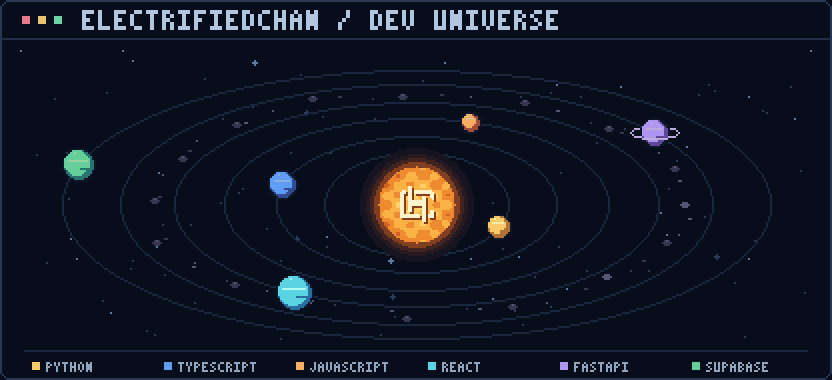

<!-- Original pixel scenes. References and build instructions: docs/PROFILE_DESIGN.md -->

  <picture>
    <source media="(prefers-reduced-motion: reduce)" srcset="./assets/sunset-cover-static.png" />
    
  </picture>

<h1 align="center">
  
</h1>

  <strong>Full-stack developer · Data Science student · Applied AI</strong> 
  Turning ideas into useful software, one experiment at a time.

  
  
  

I'm a Computer Science student specializing in Data Science. My projects bring together **AI, practical backend logic, and clean interfaces** — from interview coaching to exam logistics.

## 🚀 Featured projects

| Project | What it does | Stack |
| :--- | :--- | :--- |
| **[G.U.A.R.D.](https://github.com/electrifiedchan/guard-edge-ai-proctoring)** Vision AI | Resume-aware interviews, gaze analysis, and session replay. | `Next.js` `FastAPI` `MediaPipe` |
| **[GitReal](https://github.com/electrifiedchan/Git_real)** Developer tools | Resume checks against GitHub code, plus voice interviews. | `Next.js` `FastAPI` `Gemini` |
| **[TeamTruth](https://github.com/electrifiedchan/TeamTruth)** AI memory · MVP | AI memory that flags contradictions in team updates. | `React` `Node.js` `Groq` |
| **[ExamHub](https://github.com/electrifiedchan/exam-hub-seating-system)** Automation | CSV-to-seating plans, seat lookup, and attendance sheets. | `React` `Flask` `Pandas` |

  
<b>More builds — mobile &amp; academic tools</b>

- **[Namma Yatri](https://github.com/electrifiedchan/namma_yathri)** — A ride-hailing architecture study with demand heatmaps and driver gamification. `React Native` · `Supabase`
- **[VTU Performance Analyzer](https://github.com/electrifiedchan/vtu-performance-analyzer)** — Result-PDF parsing, SGPA/CGPA analytics, and AI study guidance. `React` · `Flask` · `scikit-learn`

## 🧰 Tech stack

  <picture>
    <source media="(prefers-reduced-motion: reduce)" srcset="./assets/solar-system-static.png" />
    
  </picture>

  

  

  Also working with React Native · Pandas · scikit-learn · MediaPipe

---

  <b>Have something interesting in mind?</b> 
  <a href="mailto:chandankushal1520@gmail.com">Let's build it.</a>

  

